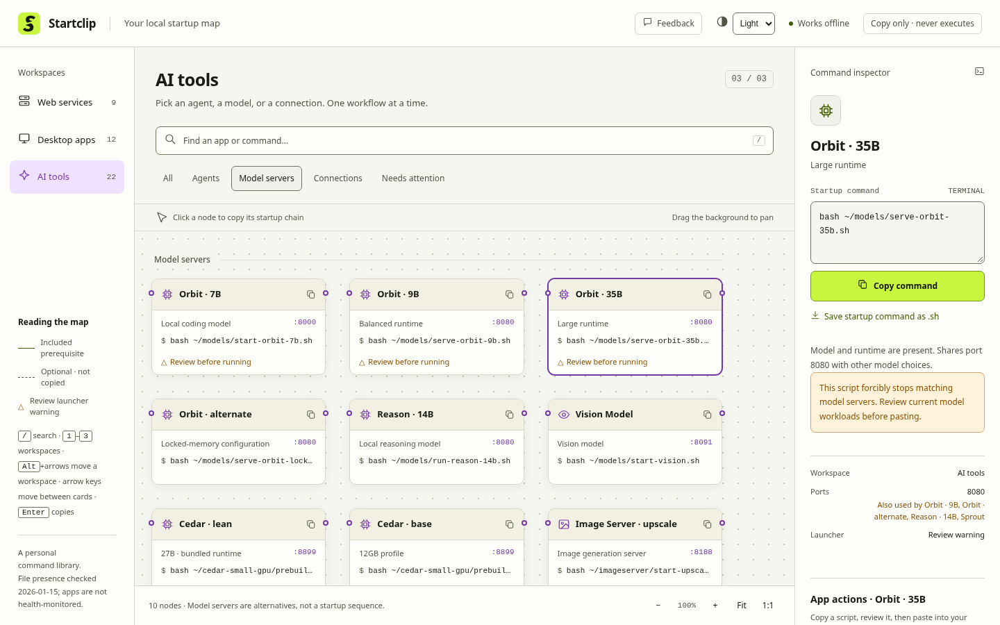
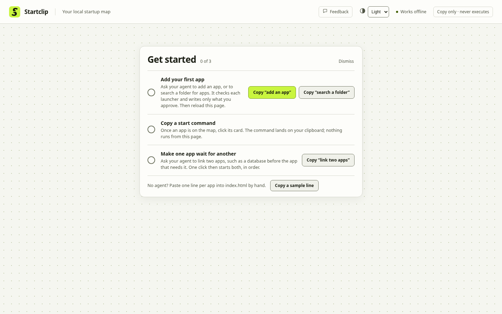

<h1 align="center">
  <picture>
    <source media="(prefers-color-scheme: dark)" srcset="docs/banner-dark.png">
    
  </picture>
</h1>

https://github.com/user-attachments/assets/996c18f8-0a33-496c-a279-1d143ec60084

**Click a card. The command is copied. Nothing runs.** Startclip is a startup map for the apps on your own machine:
Docker stacks, local model servers, AI agents and desktop tools. It is one HTML file that works offline. Click a card
and its start command lands on your clipboard, along with anything that has to start first. You read it, you paste it,
you stay in charge. It starts empty and holds only the apps you add.

<p align="center">
  <a href="https://github.com/browser-b0X/startclip/archive/refs/heads/main.zip"></a>
</p>
<p align="center">
  Free · one offline HTML file · any modern browser
</p>

[Quick start](#quick-start) ·
[Make it yours](#make-it-yours) ·
[Where it runs](#where-it-runs) ·
[Report a bug or suggest an idea](https://github.com/browser-b0X/startclip/issues/new/choose) ·
[Support the project](https://bio.site/browserb0x)

<picture>
  <source media="(prefers-color-scheme: dark)" srcset="docs/hover-trace.gif">
  
</picture>

<sub>Screenshots show a demo map. Your copy starts empty.</sub>

## Features

Local setups grow. Twelve apps means twelve commands, and some only work in the right order: the Docker engine before
the Compose stack, the model server before the agent. Startclip puts the whole setup on one page, shows what depends on
what, and leaves the running to you.

- **The right command in one click.** Every card copies exactly what starts that app.
- **Startup chains.** When an app needs something else first, its card copies a bash script that checks the tools it
  needs, reuses whatever is already running, waits until each prerequisite is ready and stops at the first failure.
- **The order, drawn for you.** Hover a card and its chain lights up across the map, prerequisites first.
- **Port clashes before they happen.** Cards that share a port say so.
- **Careful re-launch and removal.** Where the page can prove how an app was installed, it offers re-launch and removal
  scripts. They name what depends on the app and ask you to type a confirmation in a real terminal.
- **Your order.** Drag workspaces into any order, or move them with Alt and the arrow keys.
- **Keyboard first.** `/` searches, `1` to `3` switch workspaces, arrow keys walk the map and Enter copies.
- **Scripts you can keep.** Save any command or chain as a `.sh` file and read it first.
- **Light and dark, desktop and phone.** Layouts are checked at five widths in both themes, with axe-core accessibility
  checks.

## Copy-only, by design

Startclip cannot start anything, and that is the point.

- **No execution.** There are no URL schemes, no local helper and no background service. The page writes to your
  clipboard and stops there.
- **No network.** A Content-Security-Policy of `default-src 'none'` blocks every request. There are no fonts, scripts or
  images to fetch.
- **No install.** It is one `index.html` with no framework and no build step.
- **No account, no telemetry.** Your workspace order, recent copies and theme stay in your browser's local storage.

## Quick start

```
git clone https://github.com/browser-b0X/startclip.git
cd startclip
```

Then open `index.html` in your browser, or double-click it:

| System | Command |
| --- | --- |
| Linux | `xdg-open index.html` |
| macOS | `open index.html` |
| Windows (PowerShell or Command Prompt) | `start index.html` |

It opens on Get started, which shows you how to fill the map.

Shortcuts are optional. Every step asks first, the default is No, and uninstalling removes only what the script made.
Both scripts offer an app menu entry and a desktop shortcut, then print the page address and copy it so you can
bookmark it.

| System | Command | Options |
| --- | --- | --- |
| Linux | `bash setup.sh` | `--dry-run`, `--uninstall` |
| Windows | `.\setup.cmd` in PowerShell, or double-click `setup.cmd` | `-DryRun`, `-Uninstall` |

## Make it yours

Startclip ships with an empty map, and a new install opens on Get started: three steps that tick themselves as you go
(add your first app, copy a start command, make one app wait for another), with the words that fill the map ready to
copy. Your cards replace it when you reload the page, and Dismiss closes it for good.

<picture>
  <source media="(prefers-color-scheme: dark)" srcset="docs/first-run-dark.png">
  
</picture>

**With an AI agent.** The included `launchpad-add-cell` skill works in Claude Code, and any agent that can read its
`SKILL.md` and run a command can follow it. It needs an Arch-based system with `pacman`.

- Name an app: "add Obsidian to Startclip".
- Or point it at a folder: "search ~/Applications for apps to add". It lists what is not on the map yet, you choose by
  number, and it adds only your picks. The search runs nothing and opens no `.env` file.
- Link two apps: "make Open WebUI wait for Ollama in Startclip". One click then starts both, in order.

Either way it checks the launcher, package and ports on your machine, shows a dry run, and writes verified cards. If a
check fails, it restores the file byte for byte. It works when your agent runs in this folder. To use it from anywhere
in Claude Code, and for the page's Map entry buttons, link it once:

```bash
ln -s "$PWD/.claude/skills/launchpad-add-cell" ~/.claude/skills/launchpad-add-cell
```

**By hand.** Each card is one line between the `[` and `]` in `<script id="catalog">`, with a comma after every line but
the last:

```json
{"id":"obsidian","name":"Obsidian","view":"desktop","group":"daily","type":"Knowledge base","command":"/usr/bin/obsidian","note":"Opens the Obsidian desktop app.","icon":"book"}
```

Workspaces and groups live in `<script id="views">`. Dependency links, readiness checks and removal tables live in the
core script, starting at `connections`. Reload the page after an edit. `validateCatalog()` reports any mistake in a banner
on the page, and a line that breaks the JSON is reported the same way.

## Where it runs

| Part | Status |
| --- | --- |
| The page | Any modern browser. The tests run in Chromium. |
| Startup chains | Linux with bash, and fish at `/usr/bin/fish`. |
| Removal scripts | Arch-based systems (`pacman`), Docker Compose, AppImage and pipx. |
| `launchpad-add-cell` skill | Arch-based systems with `pacman`. |
| `setup.sh` | Linux. Tested in a throwaway home folder and run on CachyOS. |
| `setup.cmd` | Windows. Tested on Windows: the dry run, a full run whose shortcuts open the page, and the uninstall. |

## Development

```bash
node --test tests/
```

This runs the unit, browser and setup suites. They use a synthetic demo map in a temp copy of the page, so they pass
whatever your own map holds. The browser suite needs Playwright and axe-core, and reports itself as skipped without
them. To install them once, outside the project:

```bash
mkdir -p ~/.cache/launchpad-test-tools && cd ~/.cache/launchpad-test-tools && npm install --no-save --no-audit --no-fund playwright axe-core && npx playwright install chromium
```

`launchpad` was the working name and stays as the command-line word, so you will see it in the skill, the test tools
and the setup markers.

## Security

See [SECURITY.md](SECURITY.md) before you share screenshots, a copy of your map or a bug report.

## Feedback & Suggestions

Help make **browser-b0X** better.

- 🐛 **Found a bug?** Submit a structured [Bug report](https://github.com/browser-b0X/startclip/issues/new/choose).
  **Feedback** in the page's header opens the same page.
- 💡 **Have an idea or question?** Share it as an [Idea or suggestion](https://github.com/browser-b0X/startclip/issues/new/choose).
- 🤝 **Want to contribute?** Pull requests and improvements are always welcome. Please follow the
  [Code of conduct](CODE_OF_CONDUCT.md).

## Support the project

<p align="center">
  <a href="https://bio.site/browserb0x">
    
  </a>
</p>

Ko-fi and Buy Me a Coffee are both on that page.

> Every contribution is appreciated, but never expected.<br>
> Using the project, reporting bugs, and sharing it with others helps too.

## License

The source code and the logo files are [MIT](LICENSE), copyright 2026 browser-b0X.

The MIT License lets you copy and change the files, but not present your version as Startclip: the **Startclip name and
logo are the project's trademarks**, kept for the official project so that people can tell it from modified copies.
Forks are welcome under a different name and logo. See [TRADEMARKS.md](TRADEMARKS.md). The only official source is this
repository.

The S in the logo is cut from Fira Sans ExtraBold, used under the SIL Open Font License.
